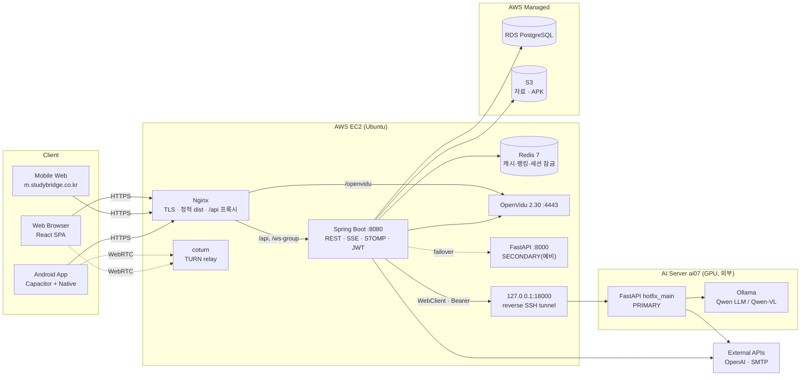

<div align="center">


# StudyBridge (스터디브릿지)

**AI 기반 통합 학습 플랫폼**

학습 자료 관리 · AI 학습메이트 · 퀴즈/오답노트 · 학습 플래너 · 그룹스터디를 하나의 서비스로 연결합니다.

2026학년도 캡스톤디자인 | 개발 기간 2026.04 – 2026.11 | Web + Android

[](frontend/package.json)
[](backend/build.gradle)
[](fastapi/requirements.txt)
[](docker-compose.yml)
[](android/)

[서비스 바로가기](https://studybridge.co.kr) · [Android 앱 받기](https://studybridge.co.kr/app) · [GitHub](https://github.com/kim-119/studyBridge) · [프로젝트 상세 문서 및 개발 기록 — Notion](https://app.notion.com/p/31b7afa8e3c98059944cd3577c508b47?v=31b7afa8e3c980fb99d8000c7c053947) · [최종 프로젝트 산출물 — Google Drive](https://drive.google.com/drive/folders/1EIJt0_i7rGLPa4L_gNQeLois1nQrECDu?hl=ko)

</div>

---

## 목차

1. [프로젝트 소개](#1-프로젝트-소개)
2. [주요 기능](#2-주요-기능)
3. [기술 스택](#3-기술-스택)
4. [시스템 아키텍처](#4-시스템-아키텍처)
5. [디렉터리 구조](#5-디렉터리-구조)
6. [시작하기](#6-시작하기)
7. [환경변수](#7-환경변수)
8. [개발 및 배포 안내](#8-개발-및-배포-안내)
9. [문서](#9-문서)
10. [개발 참여자](#10-개발-참여자)

---

## 1. 프로젝트 소개

대학생의 학습에는 PDF 강의자료, AI 질의응답, 퀴즈, 플래너, 화상 스터디 등 다양한 도구가 활용됩니다. StudyBridge는 자료 관리부터 질의응답, 문제풀이, 오답 복습, 다음 학습 계획까지 이어지는 통합 학습 경험을 제공합니다.

StudyBridge는 이 흐름을 **업로드한 학습 자료 하나를 중심으로** 연결합니다.

| 학습 요구 | StudyBridge의 제공 기능 |
|---|---|
| 자료 중심의 통합 학습 | 자료보관함에 올린 PDF에서 요약·핵심노트·퀴즈·로드맵·마인드맵을 바로 생성 |
| 학습 단계별 맞춤형 질의응답 | 교수 페르소나 멀티에이전트가 일반/소크라테스/토론/상황극 모드와 학습자 수준에 맞춰 답변 |
| 평가 결과 기반 반복 학습 | 퀴즈 자동 채점 → 오답노트 → 유사 문제 → 복습 일정 등록 |
| 협업 및 지속적인 학습 지원 | 그룹스터디(화상·화면공유·채팅·공유 퀴즈·타이머·랭킹) |
| 멀티디바이스 학습 환경 | Capacitor 기반 Android 앱 + 모바일 웹(m.studybridge.co.kr) |

## 2. 주요 기능

> 주요 기능은 2026-11-18 기준 `main` 통합 브랜치를 바탕으로 정리했습니다. 각 기능의 제공 방식과 연동 경로를 함께 안내합니다.

### AI 학습메이트
| 기능 | 제공 방식 | 구현 구성 |
|---|---|---|
| 교수 페르소나 멀티에이전트 Q&A | 제공 | `pages/StudyMate.jsx` → `POST /api/agent-rooms/{roomId}/chat` → FastAPI `/api/ai/multi-chat` |
| 소크라테스 · 토론 · 상황극 모드 | 제공 | `ChatService`(Spring) 모드 분기 + `fastapi/app/services/socratic_multi_agent.py` |
| 학습자 지식 수준 조절 | 제공 | `knowledgeLevel` → Spring 정규화 → FastAPI |
| 응답 검증 · 재생성 | 제공 | 스트리밍 검증 단계 + `forceRegenerate` |
| SSE 실시간 스트리밍 | 제공 | `POST /api/agent-rooms/{roomId}/chat/stream` (`text/event-stream`), PRIMARY→SECONDARY failover |
| 질문 중심 학습메이트(`/learning-mate`) | API 제공 · 화면 통합 | 백엔드 `POST /api/learning-mate/chat` 제공, 사용자 화면은 `/studymate`로 통합 |

### 학습 자료
| 기능 | 제공 방식 | 구현 구성 |
|---|---|---|
| PDF 업로드 · 텍스트 추출 · 자동 분류 | 제공 | `POST /api/materials/upload` → FastAPI `/api/extract`, `/api/ai/material/classify` |
| 자료보관함(폴더) | 제공 | `/api/folders`, `PATCH /api/materials/{id}/move` |
| AI 요약 · 핵심 노트 · 키워드 정의 | 제공 | `/api/materials/{id}/summary`, `/study-note`, `/keywords/define` |
| 자료 기반 질의응답 | 키워드 검색 기반 | `POST /api/materials/{id}/question`에서 키워드 유사도 Top-K 검색 제공. pgvector RAG 수집·검색은 별도 서버 모듈(`/api/rag/*`)로 구성되어 있으며 화면 질의응답은 키워드 검색 경로를 사용 |
| 학습일지 | 제공 | `/api/materials/{id}/study-journals` + AI 검증 |

### 학습 평가
| 기능 | 제공 방식 | 구현 구성 |
|---|---|---|
| 자료 기반 퀴즈 생성 · 자동 채점 · 퀴즈별 랭킹 | 제공 | `POST /api/materials/{id}/quiz`, `.../submit`, `.../ranking` |
| 오답노트 · AI 피드백 | 제공 | `pages/ReviewNotesPage.jsx` → `/api/review-notes` |
| 유사 문제 생성 | 제공 | `POST /api/review-notes/{id}/variant-question` |
| 복습 일정 등록 | 규칙 기반 제공 | `POST /api/learning-loop/review-schedule` |

### 학습 플래너
| 기능 | 제공 방식 | 구현 구성 |
|---|---|---|
| 사용자 플래너 · 주간 일정 · 시간표 PDF | 제공 | `/api/planners`, `/api/todos`, `POST /api/planners/{id}/schedule/pdf` |
| AI 로드맵(12주×7일) → 플래너 변환 | 제공 | `/api/materials/{id}/roadmap`, `POST /api/planners/from-roadmap` |
| AI 계획 분석 · AI 학습 내비게이터 | 제공 | `/api/planners/{id}/plan-analysis`, `/api/planners/{id}/adaptive` |
| 다음 학습 추천 | 규칙 기반 추천 | 추천 API를 통해 학습 규칙에 따른 다음 학습 항목 제공 |

### 학습 시각화
| 기능 | 제공 방식 | 구현 구성 |
|---|---|---|
| 마인드맵 · 의미 기반 개념 그래프 | 제공 | `POST /api/mindmap/semantic-graph`, 자체 SVG 렌더러(`components/graph/KnowledgeGraphCanvas.jsx`) |
| 지식 그래프 화면(`/obsidian`) | 제공 | `pages/ObsidianPage.jsx` |

### 그룹스터디
| 기능 | 제공 방식 | 구현 구성 |
|---|---|---|
| 그룹 생성 · 가입 신청/승인 · 비공개 초대 링크 | 제공 | `/api/groups`, `/api/groups/invite/{token}` |
| 화상 스터디 · 화면공유(방별 최대 2명) | 제공 | OpenVidu 2.30 + coturn, `POST /api/groups/{id}/video/token`, `/screen-token` |
| 공유 화면 AI 분석(동의 기반) | 제공 | `POST /api/groups/{id}/screen-ai/analyze` → 비전 모델 |
| 실시간 채팅 · 그룹 AI 봇 | 제공 | STOMP `/ws-group`, `POST /api/groups/{id}/chats/stream`(SSE) |
| 공유 퀴즈 · 퀴즈 랭킹 | 제공 | STOMP 퀴즈 세션, `/api/groups/{id}/stats/quiz-ranking` |
| 공부 타이머 | 제공 | `/api/timers/start·heartbeat·end` (서버 시각 기준, heartbeat 크레딧) |
| 출석 · 학습시간 통계 | 통계 API · 출석률 표시 | 출석·학습시간 통계 API 제공, 웹 카드에서 출석률 표시 |
| 게시판 · 신고 | 제공 | `/api/blogs`, `/api/reports` |

### 계정 · 운영
회원가입/로그인(JWT + Refresh Token), 이메일 인증 비밀번호 재설정, 1:1 문의, 관리자(정지/차단·신고 처리), 메인 배너, Android APK 배포 페이지(`/app`), 모바일 웹(`m.studybridge.co.kr`)이 구현되어 있습니다.

### Android 앱
| 기능 | 근거 |
|---|---|
| 모바일 전용 화면(홈·자료보관함·스터디메이트·플래너·오답노트·그룹스터디·마인드맵·리포트) | `frontend/src/mobile/` (`vite.mobile.config.js`로 별도 번들) |
| 네이티브 화면공유(MediaProjection + libwebrtc → OpenVidu) | `android/screenshare/` |
| 네이티브 공부 세션 · 알림 · 빠른 설정 타일 · 홈 위젯 · 학습 리마인더 | `android/app/src/main/java/kr/co/studybridge/app/` |
| Refresh Token 암호화 저장(Android Keystore AES-GCM) | `SecureSessionPlugin.kt`, `SecureSessionVault.kt` |
| 자체 업데이트 확인(`/api/app/version`) | `frontend/src/mobile/update/` |

> Android 앱 소스의 최신 개발 라인은 `android-features` → `android-main` 브랜치입니다. 자세한 내용은 [브랜치 운영](#81-브랜치-운영)을 참고하세요.

## 3. 기술 스택

버전은 의존성 파일 기준입니다.

| 영역 | 기술 |
|---|---|
| **Frontend** | React 18, Vite 5, React Router 7, Tailwind CSS 3, axios, @stomp/stompjs 7 + sockjs, openvidu-browser 2.30.0, Chart.js, FullCalendar, framer-motion, pdfjs-dist |
| **Backend** | Java 21, Spring Boot 3.2.4 (Web, WebFlux `WebClient`, Security, Data JPA, Data Redis, WebSocket/STOMP, Validation, Mail, AOP), jjwt 0.12.5, AWS SDK v2(S3), OpenPDF |
| **AI Server** | Python 3.12, FastAPI + Uvicorn, Ollama(HTTP 호출), Qwen 계열 LLM, 비전 모델(Qwen-VL 계열), OpenAI API(응답 검증·비전 답변 지원), sentence-transformers(`intfloat/multilingual-e5-base`), reranker(`BAAI/bge-reranker-v2-m3`), pgvector, LangGraph(플래그), PyMuPDF/pypdf, Tesseract OCR |
| **Database / Cache** | PostgreSQL(운영: AWS RDS, 로컬: `postgres:16`), Redis 7 |
| **Realtime** | SSE, STOMP over WebSocket, OpenVidu 2.30 + coturn 4.6 |
| **Infra** | AWS EC2(Ubuntu), AWS RDS, AWS S3, Nginx(TLS 종단·정적 서빙), Docker / Docker Compose, systemd, GitHub Actions |
| **Mobile** | Capacitor 8, Android(minSdk 24 / target 36), Java·Kotlin 2.1, Gradle 8.14 / AGP 8.13 |

> **AI 모델 구성**: `fastapi/.env.example`의 기본 텍스트 모델은 `qwen3:14b`, 코드 기본값은 `qwen2.5:14b`, 비전 모델은 `qwen3-vl:4b-instruct`입니다. 운영 모델 태그 및 양자화 설정은 GPU 서버(ai07)의 Ollama에서 관리하며, 프로젝트 문서에는 16GB VRAM 기준 `q4_K_M` 구성이 안내되어 있습니다.

## 4. 시스템 아키텍처



- **EC2와 AI 서버는 역할이 다릅니다.** EC2는 웹·API·DB 연결·영상 서버를 담당하고, LLM 추론은 별도 GPU 서버(ai07)의 FastAPI + Ollama가 담당합니다. AI 기능을 이용하는 운영 환경에서는 EC2의 `docker compose` 구성과 별도 AI 서버 연동을 함께 설정합니다.
- 브라우저의 AI 요청은 Spring API를 통해 전달되며, Spring은 PRIMARY(ai07) → SECONDARY(EC2 :8000) 순서의 장애 전환(failover) 구조를 제공합니다.
- 상세 구조와 로컬 개발 구성은 [docs/ARCHITECTURE.md](docs/ARCHITECTURE.md)에 있습니다.

## 5. 디렉터리 구조

```text
studyBridge/
├── .github/
│   ├── workflows/        # ci.yml · cd.yml(웹 배포) · android-ci.yml · android-release.yml
│   └── scripts/          # CI 보조 스크립트(wait-for-ci, 모바일 번들 가드)
├── frontend/             # React SPA (웹) + src/mobile(Android·모바일 번들)
├── backend/              # Spring Boot API 서버
├── fastapi/              # AI 서버(FastAPI) — 운영 진입점 hotfix_main.py
├── android/              # Capacitor Android 프로젝트(app, screenshare 모듈)
├── ops/                  # Nginx 설정, systemd 유닛, AI 서버 운영·배포 스크립트, APK 게시 스크립트
├── scripts/              # AI 라우트 게이트, FastAPI 기동 보조 스크립트
├── docs/                 # 설치·배포·아키텍처·통합/검증 보고서, AI 계약 문서
├── docker-compose.yml    # spring · openvidu · coturn · db · redis (+ dev 프로필 react)
├── docker-compose.override.yml  # spring 의 DB 접속값을 .env 로 주입(운영 RDS)
├── capacitor.config.json # Android 앱 설정(appId kr.co.studybridge.app)
└── package.json          # 루트 스크립트(build, build:mobile, Capacitor 의존성)
```

## 6. 시작하기

### A. 일반 사용자
1. https://studybridge.co.kr 에 접속해 회원가입 후 로그인합니다. (모바일 브라우저는 `m.studybridge.co.kr`로 이동합니다.)
2. **자료보관함**에 PDF를 올리면 요약·핵심노트·퀴즈·로드맵을 생성할 수 있습니다.
3. **스터디메이트**에서 교수 페르소나에게 질문하고, 모드(일반/소크라테스/토론/상황극)와 수준을 고릅니다.
4. 퀴즈를 풀면 틀린 문제가 **오답노트**로 이어지고, 유사 문제와 복습 일정을 받을 수 있습니다.
5. **그룹스터디**에서 그룹을 만들거나 초대 링크로 참여해 화상 스터디·타이머·공유 퀴즈를 이용합니다.
6. Android 앱은 https://studybridge.co.kr/app 에서 APK를 내려받아 설치합니다(알 수 없는 출처 허용 필요).

### B. 로컬 개발 환경 (요약)

| 필요 도구 | 버전 |
|---|---|
| JDK | 21 |
| Node.js | 20 (Android 빌드·Capacitor CLI는 22) |
| Python | 3.12 (AI 서버를 직접 띄울 때만) |
| Docker / Docker Compose | v2 |

```bash
git clone https://github.com/kim-119/studyBridge.git
cd studyBridge
cp .env.example .env            # 값 채우기 (JWT_SECRET 필수)

# 1) DB · Redis · OpenVidu 를 컨테이너로 실행
docker compose up -d db redis openvidu

# 2) Spring Boot (로컬 DB 사용 시 DB_HOST=localhost)
cd backend
export JWT_SECRET='32자 이상 임의 문자열' DB_HOST=localhost
./gradlew bootRun               # http://localhost:8080

# 3) React (다른 터미널)
cd frontend
npm ci
VITE_API_BASE_URL=http://localhost:8080 npm run dev   # http://localhost:3000
```

- 스키마는 JPA `ddl-auto: update`로 자동 생성되며 관리자 계정 등 초기 데이터는 기동 시 코드로 만들어집니다.
- AI 기능은 FastAPI + Ollama 연동을 통해 제공됩니다. 로컬 환경에서 AI 기능까지 이용하려면 AI 서버를 함께 구성하며, 규칙 기반 대체 경로는 각 기능의 설정에 따라 동작합니다.
- 전체 절차(AI 서버, 환경변수, 정상 동작 확인)는 **[docs/SETUP.md](docs/SETUP.md)** 를 참고하세요.

### C. AWS / Linux 운영 환경 (요약)

운영은 **EC2(Nginx + Docker Compose) + RDS + S3 + 별도 GPU AI 서버(ai07)** 구성입니다.

1. Ubuntu에 Docker, Docker Compose, Nginx, certbot을 설치합니다.
2. 저장소를 `/home/ubuntu/studyBridge`에 클론하고 `.env`와 `/home/ubuntu/.studybridge-secrets/spring.env`(JWT_SECRET)를 준비합니다.
3. `docker compose up -d spring openvidu coturn redis`로 백엔드 계열을 기동합니다(DB는 RDS, `DB_*`로 주입).
4. 프론트엔드는 `npm run build` 결과를 `/var/www/studybridge/releases/<sha>`에 두고 `current` 심볼릭 링크로 Nginx가 직접 서빙합니다.
5. `ops/nginx/` 설정으로 TLS 종단, `/api` 프록시(SSE 버퍼링 해제), `/ws-group`, `/openvidu` 경로를 구성합니다.
6. AI 서버(ai07)는 별도 GPU 머신에서 FastAPI + Ollama로 운영하며, EC2와는 reverse SSH tunnel(`127.0.0.1:18000`)로 연결됩니다.

자세한 배포 절차·CI/CD·복구 및 운영 점검은 **[docs/DEPLOYMENT.md](docs/DEPLOYMENT.md)** 에 있습니다.

## 7. 환경변수

비밀값은 환경변수 및 별도 보안 설정으로 관리합니다. 루트 [`.env.example`](.env.example)과 [`fastapi/.env.example`](fastapi/.env.example)을 복사해 사용하세요.

| 변수 | 용도 | 필수 | 서비스 |
|---|---|---|---|
| `JWT_SECRET` | Spring 기동에 필요한 JWT 서명 키 | ✅ | Spring |
| `DB_HOST` `DB_PORT` `DB_NAME` `DB_USER` `DB_PASSWORD` | PostgreSQL/RDS 접속 | ✅ | Spring |
| `SPRING_DATA_REDIS_HOST` `SPRING_DATA_REDIS_PORT` | Redis | ✅ | Spring |
| `AWS_ACCESS_KEY_ID` `AWS_SECRET_ACCESS_KEY` `AWS_REGION` `AWS_S3_BUCKET` | 자료·APK 저장(S3) | 업로드 기능 사용 시 | Spring, FastAPI |
| `FASTAPI_PRIMARY_BASE_URL` `FASTAPI_SECONDARY_BASE_URL` | AI 서버 주소(failover) | AI 사용 시 | Spring |
| `AI_SERVER_API_KEY` | Spring↔FastAPI 공유 Bearer 키 (양쪽 동일 값) | 운영 권장 | Spring, FastAPI |
| `OPENVIDU_SECRET` `OPENVIDU_PUBLICURL` | 화상 서버 | 그룹 화상 사용 시 | Spring, OpenVidu |
| `TURN_USERNAME` `TURN_PASSWORD` `TURN_PUBLIC_IP` `TURN_PRIVATE_IP` | coturn relay | 원격 화상 사용 시 | coturn |
| `SMTP_HOST` `SMTP_PORT` `SMTP_USERNAME` `SMTP_PASSWORD` `SMTP_FROM` | 비밀번호 재설정 메일 발송 설정 (SMTP 설정 필요) | 선택 | Spring |
| `OLLAMA_BASE_URL` `OLLAMA_MODEL` `VISION_MODEL` | LLM / 비전 모델 | AI 서버 | FastAPI |
| `OPENAI_API_KEY` | 응답 검증·비전 답변 지원 | 선택 | FastAPI |
| `VITE_API_BASE_URL` | 프론트가 호출할 API 오리진(기본: 같은 오리진) | 로컬 개발 시 | Frontend(빌드 시) |

전체 목록과 주의사항은 [docs/SETUP.md](docs/SETUP.md#환경변수)에 있습니다. GitHub Actions 비밀값(`EC2_HOST`, `EC2_SSH_KEY`, `ANDROID_KEYSTORE_*` 등)은 [docs/DEPLOYMENT.md](docs/DEPLOYMENT.md#github-secrets)를 참고하세요.

## 8. 개발 및 배포 안내

### 8.1 브랜치 운영
| 브랜치 | 역할 |
|---|---|
| `main` | 기본 브랜치. 웹·백엔드·AI·Android 코드를 모두 담는 통합 기준선 |
| `LLM-clean` | **현재 웹/백엔드/AI 운영 배포 브랜치** — push 시 `cd.yml`이 EC2에 자동 배포 |
| `android-features` | Android 개발 브랜치 — push 시 `android-release.yml`이 서명 APK를 빌드·게시 |
| `android-main` | Android 안정 브랜치(Android CI 대상, `docs/`·`fastapi/`·`ops/`·`scripts/`는 범위 밖) |
| `feature/*`, `fix/*` | 작업 브랜치 → PR로 병합 |

> `main`은 통합 소스코드 기준선이며, 운영 배포는 `LLM-clean`을 통해 진행됩니다. 배포 트리거 변경은 별도 승인 절차에 따라 관리합니다([docs/BRANCH_MERGE_REPORT.md](docs/BRANCH_MERGE_REPORT.md)).

### 8.2 Pull Request 절차
1. 기능 브랜치에서 작업 후 PR 생성 → `ci.yml`(백엔드 빌드·단위 테스트, 프론트 빌드, FastAPI 컴파일, Docker 빌드) 통과 확인
2. 리뷰 후 병합. 운영 반영은 `LLM-clean` 병합으로 이루어지며 `cd.yml`이 동일 SHA의 CI 성공을 확인한 뒤 배포합니다.

### 8.3 CI/CD 개요
| 워크플로 | 트리거 | 하는 일 |
|---|---|---|
| `ci.yml` | `main`, `LLM-clean`, `develop`, `feature/**` 등 push/PR | 백엔드 빌드·테스트, 프론트 빌드, FastAPI 컴파일, Docker 이미지 빌드 |
| `cd.yml` | `LLM-clean` push, 수동 | 프론트 정적 릴리스(심볼릭 링크 전환) · Spring 이미지 재빌드(`:prev` 롤백) · EC2 FastAPI 재기동 |
| `android-ci.yml` | `android-features`, `android-main` push/PR | 모바일 lint·테스트, 모바일 번들, Gradle 테스트·lint·Debug APK |
| `android-release.yml` | `android-features` push, 수동 | 버전 자동 증가 → 서명 APK/AAB → EC2·S3 게시 |

### 8.4 운영 및 유지보수 가이드
- `.env`, 키스토어, SSH 키는 `.gitignore` 및 별도 보안 설정으로 관리하며 Git 커밋 대상에서 제외합니다.
- `cd.yml`은 EC2 작업 트리에서 `git reset --hard`를 실행하여 배포 기준 버전을 유지합니다. 운영 변경사항은 배포 전 Git에 반영하거나 별도로 백업합니다.
- 엔티티 변경은 `ddl-auto: update`가 nullable 컬럼만 자동 추가합니다. enum 체크 제약·인덱스 등은 RDS에 수동 반영이 필요합니다.
- AI 기능 변경은 EC2(SECONDARY)와 ai07(PRIMARY) 양쪽 배포가 필요합니다.

## 9. 문서

| 문서 | 내용 |
|---|---|
| [프로젝트 상세 문서 및 개발 기록 — Notion](https://app.notion.com/p/31b7afa8e3c98059944cd3577c508b47?v=31b7afa8e3c980fb99d8000c7c053947) | 팀 개발 일정·작업 기록(캘린더) |
| [최종 프로젝트 산출물 — Google Drive](https://drive.google.com/drive/folders/1EIJt0_i7rGLPa4L_gNQeLois1nQrECDu?hl=ko) | 캡스톤디자인 최종 제출 자료 및 프로젝트 산출물 |
| [docs/SETUP.md](docs/SETUP.md) | 로컬 개발 환경 설치 |
| [docs/DEPLOYMENT.md](docs/DEPLOYMENT.md) | 운영 배포·CI/CD·복구 및 운영 점검 |
| [docs/ARCHITECTURE.md](docs/ARCHITECTURE.md) | 전체 구조·데이터 흐름 |
| [docs/BRANCH_MERGE_REPORT.md](docs/BRANCH_MERGE_REPORT.md) | 브랜치 통합 보고서 |
| [docs/VERIFICATION_REPORT.md](docs/VERIFICATION_REPORT.md) | 테스트·검증 결과 |
| [docs/ai-contracts/](docs/ai-contracts/) | Spring↔AI 서버 계약 문서 |
| [ops/nginx/README.md](ops/nginx/README.md) | Nginx 설치·롤백 |
| [ops/android/README.md](ops/android/README.md) | APK 게시 절차 |

## 10. 개발 참여자

| 이름 | 주요 담당 영역 |
|---|---|
| 김도현 | AI 서버(FastAPI)·멀티에이전트, CI/CD·배포, 그룹스터디 화상(OpenVidu), 브랜치 관리 |
| 김재현 | 백엔드(Spring), 인증, 자료보관함, 인프라, AI 연동 |
| 강영준 | 프론트엔드, 자료보관함·관리자 화면 |
| 장재홍 | 프론트엔드, 멀티에이전트·그룹스터디·타이머 화면 |
| 고병준 | 백엔드, 관리자·신고·문의, 그룹스터디·타이머 |

**지도교수**: 김기종 교수

> 담당 영역은 Notion "개발 일정" 보드의 담당자·태그 기록을 기준으로 정리했습니다.
