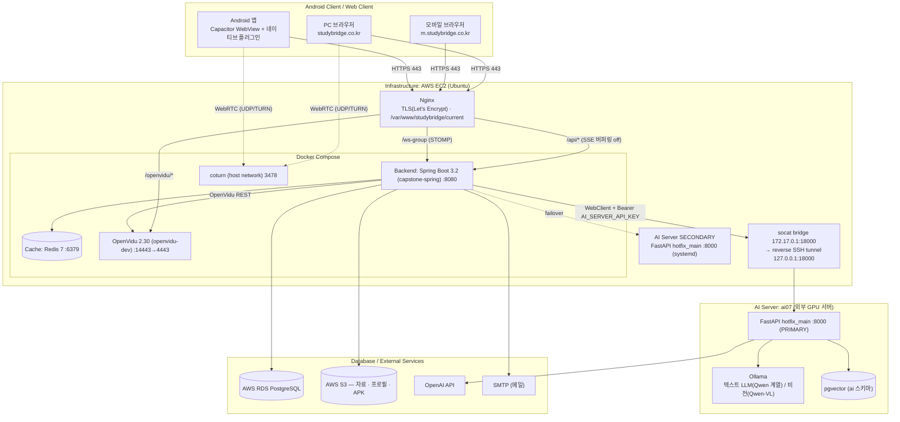
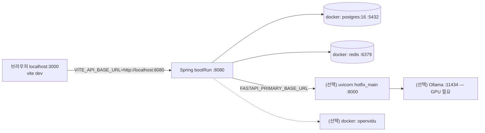
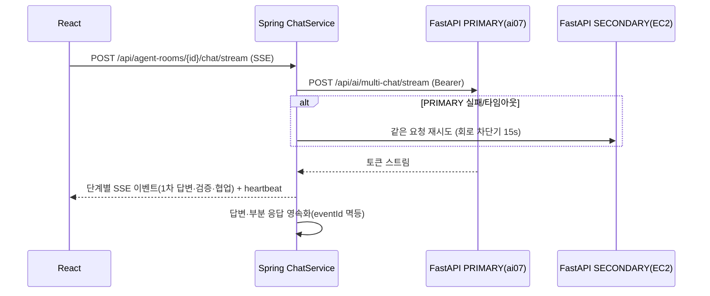

# StudyBridge 아키텍처

이 문서는 운영 환경과 로컬 개발 환경의 구성, 주요 요청 흐름, 코드 위치를 설명합니다.
근거 파일은 각 절에 표기했습니다.

---

## 1. 운영 환경 (Production)

| 구성요소 | 역할 | 근거 |
|---|---|---|
| Nginx (호스트) | TLS 종단, 정적 프론트 서빙, `/api`·`/ws-group`·`/openvidu` 프록시, 모바일 UA → `m.` 리다이렉트, 알 수 없는 Host 차단 | `ops/nginx/*.conf` |
| 프론트엔드 | Vite 빌드 결과를 `/var/www/studybridge/releases/<sha>`에 두고 `current` 심볼릭 링크로 전환. `capstone-react` 컨테이너(`profiles: [dev]`)는 운영에 쓰지 않음 | `cd.yml`, `docker-compose.yml` |
| Spring Boot | 인증(JWT), 비즈니스 로직, AI 오케스트레이션(SSE 단계 구성), STOMP, OpenVidu 토큰 발급, S3 | `backend/` |
| Redis | 캐시, 랭킹(ZSET), 화면공유 슬롯 잠금, 비밀번호 재설정 코드, 전시 계정 기기 슬롯 | `backend/.../service` |
| RDS | 운영 DB (`docker-compose.override.yml`이 `DB_*`로 주입). 로컬 `capstone-db` 컨테이너는 운영에서 쓰지 않음 | `docker-compose.override.yml` |
| ai07 | LLM 추론 서버(GPU). FastAPI `hotfix_main:app` + Ollama. EC2와 reverse SSH tunnel로 연결 | `ops/systemd/`, `ops/studybridge-ai07-autodeploy.sh` |
| EC2 FastAPI | ai07 장애 시 SECONDARY. 같은 코드, 같은 키 | `ops/studybridge-fastapi.service`, `cd.yml` |

### EC2와 AI 서버의 역할 구분
- **EC2**: 사용자 요청을 받는 모든 서비스(웹, API, DB 연결, 실시간 영상). GPU가 없습니다.
- **ai07**: LLM/비전 추론과 RAG. 저장소의 `fastapi/` 코드를 `ops/studybridge-ai07-autodeploy.sh`로 별도 배포합니다.
- 따라서 **EC2에서 `docker compose up`만으로는 AI 기능이 완성되지 않습니다.** AI07(또는 로컬 GPU + Ollama)이 필요합니다.

## 2. 로컬 개발 환경

운영과의 차이: Nginx 없음(프론트가 다른 오리진에서 API 호출, CORS `*` 허용), RDS 대신 로컬 Postgres, AI 서버는 선택.

## 3. 주요 요청 흐름

### 3.1 인증
1. `POST /api/users/login` → Access Token(JWT, 기본 30분) + Refresh Token 발급.
2. 프론트 `services/api.js`의 axios 인터셉터가 `Authorization: Bearer` 를 붙이고, 401이면 `POST /api/users/refresh`로 한 번 갱신 후 재시도합니다.
3. Android 앱은 Refresh Token을 Android Keystore 기반 AES-GCM으로 암호화해 보관합니다(`SecureSessionVault.kt`).

### 3.2 AI 학습메이트 (SSE)

- 단계(1차/2차/3차) 구성은 FastAPI가 아니라 **Spring `ChatService`** 에 있습니다.
- Nginx는 `/api/`에 `proxy_buffering off`, 긴 read timeout을 적용합니다.

### 3.3 자료 → 학습 루프
`PDF 업로드` → (Spring) S3 저장 + FastAPI `/api/extract` 텍스트 추출 → 요약/핵심노트(백그라운드) → 퀴즈 생성 → 채점 → 오답노트 → 유사 문제 → 복습 일정(`todos`) → 플래너/로드맵.

### 3.4 그룹스터디
- 채팅·공유 퀴즈: STOMP over SockJS(`/ws-group`), 브로커 `/topic`, 앱 prefix `/pub`.
- 영상: Spring이 OpenVidu 세션/토큰 발급 → 브라우저·앱이 OpenVidu + coturn으로 WebRTC 연결.
- 화면공유: 방별 최대 2명(Redis 잠금). Android는 네이티브 MediaProjection 모듈로 송출.
- 타이머: 서버 시각 기준, 30초 heartbeat 크레딧, 90초 reaper.

## 4. 코드 지도

| 위치 | 내용 |
|---|---|
| `frontend/src/pages/` | 웹 화면(라우트는 `App.jsx`) |
| `frontend/src/services/api.js` | 모든 REST 호출과 토큰 갱신 |
| `frontend/src/mobile/` | 모바일·Android 전용 화면(별도 번들 `vite.mobile.config.js`) |
| `backend/src/main/java/com/studybridge/api/controller/` | REST/STOMP 컨트롤러 |
| `backend/.../service/` | 도메인 서비스, AI 클라이언트(`AiFailoverExecutor`, `AiMultiChatFailoverService`) |
| `backend/.../security/` | Spring Security, JWT |
| `fastapi/main.py`, `fastapi/hotfix_main.py` | AI 서버 진입점(운영은 `hotfix_main:app`) |
| `fastapi/app/api/` | AI 라우터 |
| `fastapi/app/services/` | 멀티에이전트, Ollama/OpenAI 클라이언트, RAG, 비전 |
| `android/app/` | Capacitor 앱 + 네이티브 공부 세션·알림·위젯 |
| `ops/` | Nginx, systemd, AI 서버 배포·검증 스크립트, APK 게시 |

## 5. 알려진 구조적 제약
- `fastapi/Dockerfile`은 운영 진입점(`hotfix_main`)과 맞지 않는 오래된 파일입니다. 운영 AI 서버는 Docker가 아닌 systemd + venv로 동작합니다.
- `STUDYBRIDGE_AI.md`의 일부 내용(`./mvnw`, `capstone-ai-db :5433` 등)은 현재 구성과 다릅니다.
- `backend/src/main/resources/db/migration/*.sql`은 Flyway 미도입으로 자동 적용되지 않습니다.
- 문서 기반 벡터 RAG(pgvector) 코드는 존재하나 자료 Q&A 화면 경로는 키워드 유사도 검색을 사용합니다.
